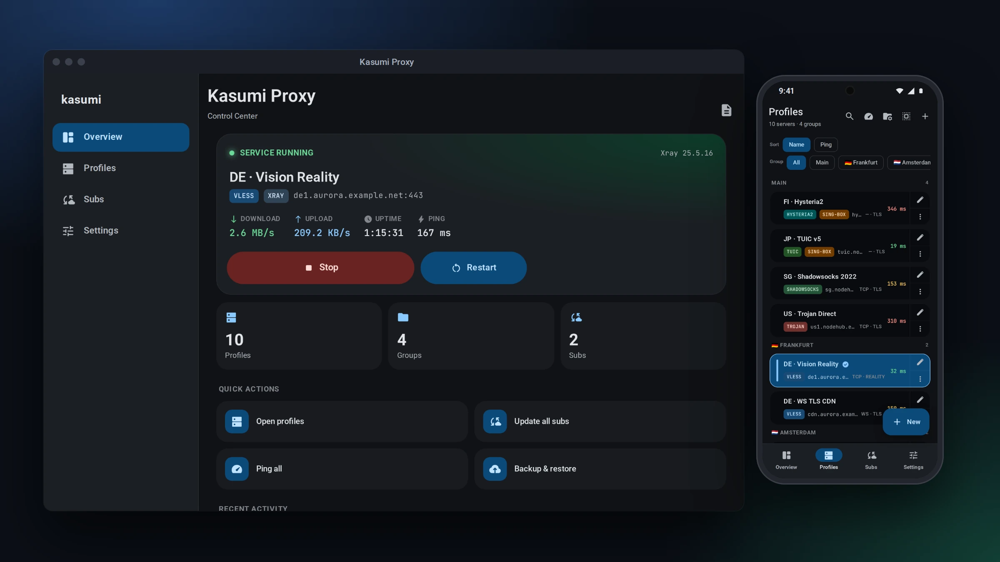
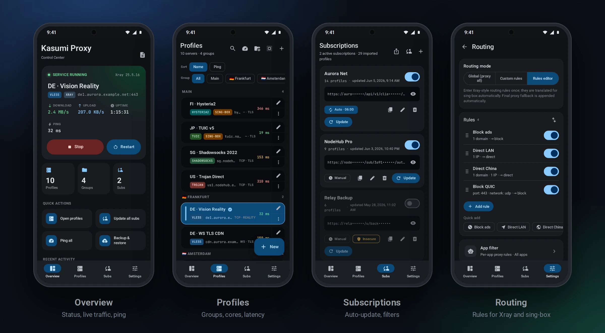

<p align="center">
  
</p>

<h1 align="center">Kasumi Proxy</h1>

<p align="center">
  System-wide transparent proxy on Xray-core / sing-box for <b>rooted Android</b>, <b>Linux</b> and <b>Windows</b>.
</p>

<p align="center">
  <a href="https://github.com/loss-and-quick/Kasumi-Proxy/actions/workflows/ci.yml"></a>
  <a href="https://github.com/loss-and-quick/Kasumi-Proxy/releases/latest"></a>
  <a href="https://github.com/loss-and-quick/Kasumi-Proxy/issues"></a>
  <a href="LICENSE"></a>
</p>

- **Android:** a Magisk / KernelSU / APatch module. It runs the core as a root daemon and routes
  traffic with `iptables` / `ip rule`, not through `VpnService`.
- **Desktop:** a Tauri 2 app that brings up a real TUN. Proxy-only, system-proxy and PAC modes
  are also available.

Both run the same Rust backend and the same React UI.

<p align="center">
  
</p>

> [!NOTE]
> This is a fork of [vincentng295/Magic_V2Ray](https://github.com/vincentng295/Magic_V2Ray). Most
> of the code was written by AI, so review it before you trust it.

## Features

- **Two cores.** Xray-core and sing-box, picked per profile. Supported protocols are VLESS, VMess,
  Trojan, Shadowsocks, SOCKS, HTTP, WireGuard, Hysteria2, TUIC, AnyTLS, Naive and ShadowTLS.
- **Import.** Subscription URLs, share links, mixed text and QR codes, plus Happ's `happ://add`,
  `happ://routing` and encrypted `happ://crypt` … `crypt5` links, and Incy's encrypted
  `incy://crypt1` links, pasted or scanned. An encrypted link is kept as given and decrypted on
  each update; an Incy link also names the subscription after its provider.
- **Subscriptions.** Groups of servers that can be updated in one tap, or in the background
  with no UI open.
- **Happ-compatible subscriptions**, decoded by [happ-sub](https://github.com/loss-and-quick/happ-sub):
  - the provider's title, traffic and expiry, announcements and update interval, from headers and
    `#key:` directives;
  - requests that identify like Happ (User-Agent, HWID, device headers): Android Happ on a phone,
    Happ desktop on Linux; editable per subscription or in Settings;
  - or, per subscription, like Incy (its User-Agent, `x-` headers and device ID; Incy desktop on
    Linux), the default for a subscription added from an `incy://` link;
  - changes the provider proposes (a new URL or domain, a fallback URL, routing profiles, tunnel
    tweaks) apply only after you review and accept them;
  - JSON bodies: full Xray configs, once you allow them, keep only their outbounds and routing;
    sing-box configs become regular profiles.
- **Honest status.** An end-to-end probe tells *connected* apart from *no internet* and *failed*.
- **Diagnostics.** TCP ping, real ping and a speed test for each profile.
- **Per-app routing** on Android, plus a choice of TUN engine: tun2socks, hev-socks5-tunnel or
  sing-box.

### Why a root module rather than a VPN app?

- The root daemon is not killed by the low-memory killer, so the tunnel does not drop and leak
  your IP.
- Traffic is intercepted in the kernel (Netfilter) and never passes through a user-space
  `tun0`.
- Switching between Wi-Fi and mobile data reapplies the routing rules on the fly.

> [!TIP]
> No root? Use an ordinary client from the
> [Xray-core GUI list](https://github.com/XTLS/Xray-core#gui-clients).

## Screenshots

<p align="center">
  
</p>

## Install

Download the file for your platform from the
[latest release](https://github.com/loss-and-quick/Kasumi-Proxy/releases/latest).

| Platform | File | Notes |
| --- | --- | --- |
| Android (root) | `kasumi-proxy-module-vX.Y.Z.zip` | Flash it in Magisk / KernelSU / APatch, then reboot. Open the UI with the module's **Action** button or its WebUI entry. |
| Linux | `.deb`, `.AppImage` | Asks for `pkexec` / `sudo` to set up the TUN and routes. |
| Linux, portable | `kasumi-proxy-linux-portable-vX.Y.Z.zip` | Unzip and run `./kasumi-desktop`. All state stays next to the binary. |
| Windows | `-setup.exe`, `.msi` | Needs administrator rights (UAC) for the TUN. |
| Windows, portable | `kasumi-proxy-windows-portable-vX.Y.Z.zip` | Unzip and run `kasumi-desktop.exe`. |
| Nix / NixOS | — | See [docs/nix.md](docs/nix.md). |

On Android, state and logs live in `/data/adb/kasumi-proxy/`.

<details>
<summary><b>Verifying the AppImage signature</b></summary>

AppImages are signed with the key in [`release-signing-key.asc`](release-signing-key.asc)
(`2AA0 03A9 D670 653C FAA8  F7B0 88BE 4761 6D49 65E9`):

```sh
gpg --import release-signing-key.asc
./Kasumi*.AppImage --appimage-extract '.appimage_signature'
gpg --verify squashfs-root/.appimage_signature Kasumi*.AppImage
```

</details>

<details>
<summary><b>Linux AppImage: helper and authorization</b></summary>

Only the small `kasumi-helper` needs data-path privileges; the GUI stays unprivileged. An
AppImage cannot retain file capabilities on its temporary mount, so it normally elevates the
bundled helper for each session. When `pkexec` needs interactive authorization, a
desktop-launched app needs a running graphical polkit agent. The `/dev/tty` authentication
error means pkexec could not use its textual fallback; it does not by itself mean a special
AppImage policy is missing. If Kasumi selects `sudo` instead, it relies on sudo's own policy:
authorization already valid for that launch context, a configured non-interactive mechanism,
or an accessible controlling terminal. Kasumi does not collect passwords and closes the
helper's standard input.

An administrator can instead install a matching helper with file capabilities. After the
explicit `KASUMI_HELPER_BIN` override, NixOS wrapper and capped bundled helper, Kasumi checks
`/usr/local/bin/kasumi-helper` and `/usr/bin/kasumi-helper`. These implicit installed paths
must resolve to a root-owned executable with protected parent directories; group/other write
permission is not accepted. Kasumi does not install or elevate these fallback candidates.

Prefer the native package when available: its install hooks provision the helper. For a manual
installation, use the helper from the same trusted release, with its runtime dependencies
available on the host. Do not assume a binary copied out of an AppImage is standalone.
For example, after obtaining a suitable helper:

```sh
sudo install -o root -g root -m 0755 /path/to/kasumi-helper /usr/local/bin/kasumi-helper
sudo setcap cap_net_admin,cap_net_raw,cap_chown,cap_dac_override+ep /usr/local/bin/kasumi-helper
getcap /usr/local/bin/kasumi-helper
```

Keep the installed helper updated with the app. A missing or mismatched helper protocol is
rejected; replace the installed helper rather than bypassing the compatibility check. If no
eligible installed helper exists, the AppImage retains the bundled-helper authorization path.

</details>

## Development

Build steps, checks and the repository layout are in [CONTRIBUTING.md](CONTRIBUTING.md). Nix is
optional: plain `cargo` and `bun` are enough.

## Acknowledgments

Kasumi Proxy ships prebuilt binaries from
[Xray-core](https://github.com/XTLS/Xray-core), [sing-box](https://github.com/SagerNet/sing-box),
[tun2socks](https://github.com/xjasonlyu/tun2socks) and
[hev-socks5-tunnel](https://github.com/heiher/hev-socks5-tunnel). See
[module/bin/README.md](module/bin/README.md) for their licenses.

## License

[GPL-3.0](LICENSE)
